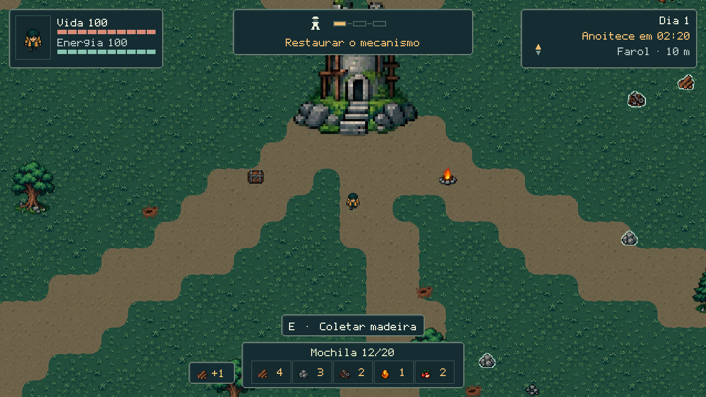
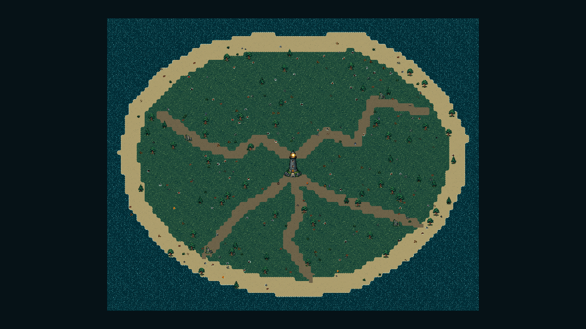

# O Farol Game Design Document

Versão do protótipo em 02/10/2026. A versão em PDF possui paginação e diagramação para apresentação.

Estado atual do protótipo em 2 de outubro de 2026

Este GDD reúne o jogo que está implementado: exploração de uma ilha, sobrevivência, coleta, abrigo, combate, três reparos do farol e resgate. Ele serve como referência para a equipe, para a apresentação escolar e para os próximos testes. A narrativa de mistério permanece provisória; as regras numéricas descrevem o código atual.

HUD Faroleiro no protótipo atual. Estado preparado para demonstrar os indicadores.

| Aspecto | Definição atual |
| --- | --- |
| Gênero | Sobrevivência 2D com exploração e objetivo de reconstrução |
| Perspectiva e modo | Vista de cima; um jogador local |
| Plataforma | Computador; projeto executado na Godot 4.7.1 |
| Entrega prevista | Protótipo escolar até 13/10/2026, conforme escopo aprovado |
| Condição de vitória | Concluir os três reparos e acender o farol por interação |
| Documentos visuais | Moodboard.pdf e capturas na subpasta Moodboard |

O núcleo jogável está implementado e tem verificações automáticas. Ritmo, dificuldade e legibilidade em movimento ainda precisam de uma partida humana completa. Este documento não apresenta ideias futuras como recursos já existentes.

## Conceito e narrativa

### Premissa

O protagonista é descendente de uma família de exploradores desaparecida décadas antes. Documentos o levam a investigar uma ilha ausente dos mapas modernos. Depois de um acidente marítimo, ele chega sozinho à costa e encontra um farol inacabado. Reconstruir esse farol é sua chance de sinalizar a posição e conseguir um resgate.

O roteiro-base é chamado O Último Faroleiro. O mistério da família e do sinal orienta a atmosfera, mas essa direção narrativa é provisória. No protótipo, ela aparece em textos de introdução e encerramento; não há diálogos, investigação interativa ou revelação posterior ao resgate.

### Experiência pretendida

A distância da base deve criar uma decisão concreta: continuar procurando recursos ou voltar a tempo de preparar a noite. A luz do abrigo funciona como referência de segurança. A reconstrução torna o progresso visível e dá propósito às saídas pela ilha.

| Pilar | Como aparece no jogo |
| --- | --- |
| Explorar com risco | Sair do abrigo, localizar materiais e enfrentar animais |
| Preparar o retorno | Guardar a mochila, reservar comida e abastecer a fogueira |
| Reconstruir para escapar | Aplicar recursos em três reparos e escolher quando partir |

### Limites narrativos e de escopo

A partida não tem limite de dias nem termina automaticamente no último reparo. A morte devolve o jogador ao abrigo e preserva parte do progresso. O jogador decide acender o farol quando estiver pronto. O foco atual é esse ciclo, sem missões secundárias ou sistemas paralelos.

### Referências históricas

Os registros de design citam O Peregrino e KeepUp Survival para movimento, Winter Survival e Survive the Nights para sobrevivência, 99 Noites na Floresta para a base como centro e Hollow Knight para estética. São referências em investigação; o projeto não reproduz seus sistemas completos nem utiliza seus assets.

## Ciclo de jogo e controles

### Fluxo principal

Menu inicial → nova expedição ou continuar → introdução → exploração e coleta → retorno ao abrigo → depósito e fogueira → reparo → nova saída. Depois do terceiro reparo, a interação de acender o farol leva ao resgate e à tela de vitória.

### Começo da expedição

A nova partida começa na noite do dia 1, no tempo interno 270 segundos, com 100 de vida, 100 de energia, mochila e depósito vazios, farol sem reparos e fogueira sem combustível. Restam 90 segundos até o primeiro amanhecer. A introdução informa esse início noturno.

| Ação | Controle e comportamento |
| --- | --- |
| Mover | WASD; movimento em oito direções |
| Correr | Segurar Shift enquanto se move; usa energia |
| Mirar | Posição do mouse define a direção do golpe |
| Atacar | Clique esquerdo; golpe de curto alcance |
| Interagir | E; coleta recurso ou abre abrigo próximo |
| Comer | Q; consome comida da mochila quando a vida não está cheia |
| Pausar | Esc; com o abrigo aberto, fecha primeiro esse painel |
| Organizar materiais | Botões no painel do abrigo; o tempo continua passando |

### Dia e noite

Um ciclo completo dura seis minutos: quatro de dia e dois de noite. O HUD mostra o tempo restante para a próxima fase. Um aviso aparece 30 segundos antes da noite. O amanhecer aumenta o número do dia, renova os recursos comuns, ajusta os inimigos e salva um checkpoint.

Pausar, ler a introdução e permanecer no menu suspendem a simulação. Abrir o depósito durante a partida não pausa; organizar materiais à noite continua exigindo atenção ao combustível e à segurança.

## Ilha e distribuição de recursos

Visão geral da ilha fixa com farol central, caminhos, vegetação, ruínas e faixa costeira.

### Geografia e navegação

A ilha tem contorno fixo, desenhado com TileMapLayer e atlas de terreno de 32×32. O farol, o depósito e a fogueira formam a base. Ruínas e áreas de vegetação compõem as saídas de exploração. A costa impede sair da área navegável; farol, depósito e ruínas bloqueiam movimento. Recursos, árvores, pedras pequenas, decoração e fogueira são atravessáveis.

### Distribuição atual

Existem 69 pickups por expedição: 24 madeiras, 18 pedras, 16 sucatas, 8 comidas e 3 peças. Ao iniciar, uma semente redistribui os recursos no terreno. O contorno e as construções permanecem fixos; carregar o save recupera a mesma distribuição.

O posicionamento evita a costa, as construções, as decorações e a área inicial, mantendo espaçamento entre pickups. As três peças são posicionadas primeiro e precisam estar a pelo menos 650 unidades do centro. Os demais tipos não têm uma regra que os limite a regiões específicas.

Os planos iniciais descreviam madeira e pedra perto, sucata nas ruínas e peças nos extremos da ilha. O código atual usa distribuição aleatória com essas restrições, portanto essas localizações históricas não são garantias para o jogador.

## Jogador e combate

### Movimento e energia

| Parâmetro | Valor atual |
| --- | --- |
| Vida e energia máximas | 100 cada |
| Velocidade de caminhada | 165 unidades por segundo |
| Velocidade de corrida | 265 unidades por segundo |
| Consumo durante corrida | 28 de energia por segundo |
| Recuperação sem correr | 19 de energia por segundo |
| Exaustão | Ao chegar a 0; a corrida libera novamente a partir de 25 |

O jogador usa CharacterBody2D, colisão com mundo e animações para caminhada, repouso e golpe. A direção de movimento ou a mira atual orienta o sprite e a área de ataque. Os valores de velocidade são unidades internas; não representam metros reais.

### Animais e dano

| Regra | Valor ou efeito |
| --- | --- |
| Espécies atuais | Uma espécie de animal hostil |
| Vida do animal | 65; um golpe do jogador causa 35 |
| Intervalo entre golpes | 0,45 segundo; dois acertos derrotam um animal |
| Dano do animal | 14 por contato de ataque; intervalo de 1,1 segundo |
| Proteção após dano | 0,35 segundo para evitar dano repetido imediato |
| Movimento do animal | 92 unidades/s de dia; 110 à noite |
| Detecção | 370 unidades de dia; 860 à noite |

Animais perseguem o jogador dentro da distância de detecção, recebem empurrão ao serem atingidos e evitam a área de abrigo quando protegida. Fora de perseguição, movimentam-se lentamente. Não atacam o farol nem o depósito e não fornecem loot.

Durante o dia são três animais. À noite, a quantidade é o menor valor entre 12 e 3 + número do dia: quatro na primeira noite, aumentando até o teto de doze. Eles são reposicionados nas trocas de fase; não há combate ativo no menu ou na pausa.

## Inventário abrigo e sobrevivência

| Recurso | Uso atual |
| --- | --- |
| Madeira | Reparos da estrutura e do mecanismo; combustível da fogueira |
| Pedra | Reparos da estrutura e da lanterna |
| Sucata | Reparos do mecanismo e da lanterna |
| Peças | Três itens únicos necessários aos dois últimos reparos |
| Comida | Consumir com Q para recuperar até 25 de vida |

### Mochila e depósito

A capacidade total da mochila é 20 unidades, somando todos os tipos. Uma coleta acrescenta uma unidade. A quantidade aparece junto do ícone e a capacidade total fica em destaque quando cheia. O depósito não tem limite definido. Guardar transfere toda a mochila; retirar transfere uma unidade do tipo escolhido, se houver espaço.

### Fogueira e área segura

Uma madeira acrescenta até 30 segundos de combustível, com reserva máxima de 240 segundos. O abastecimento usa primeiro madeira carregada e depois madeira guardada. O combustível só diminui à noite: quatro madeiras cobrem uma noite completa de 120 segundos. Combustível positivo protege a área de raio 180 unidades em torno da base; sem reserva, animais podem alcançar o jogador.

A aparência da fogueira e sua luz respondem à reserva e à noite. Abrir o abrigo exige estar a até 185 unidades do centro. A proteção não permite exploração remota: sair do círculo devolve o risco de perseguição e dano.

### Morte e recuperação

Ao morrer, o jogador reaparece no abrigo na manhã do dia seguinte, com vida e energia cheias. A mochila é perdida; depósito, combustível restante e reparos são preservados. Recursos comuns voltam a ficar disponíveis. Peças únicas que estavam na mochila retornam ao seu ponto da expedição; peças guardadas ou já utilizadas não reaparecem. A recuperação gera um checkpoint.

A sobrevivência usa vida, energia, comida e fogo. Não existem barras de fome ou sede, cura automática contínua, fabricação livre ou construção de novas bases.

## Reconstrução e economia

### Três reparos sequenciais

O painel do abrigo informa materiais guardados e custos do próximo reparo. Cada etapa exige seus materiais completos no depósito; itens que continuam na mochila não pagam o reparo. Um reparo consome os custos, altera o farol visualmente, acende um marco no HUD e salva o progresso.

| Etapa | Materiais do depósito |
| --- | --- |
| 1  Reforçar a estrutura | 10 madeiras e 8 pedras |
| 2  Restaurar o mecanismo | 8 madeiras, 6 sucatas e 1 peça |
| 3  Montar a lanterna | 8 pedras, 8 sucatas e 2 peças |

| Total para os três reparos | Quantidade |
| --- | --- |
| Madeira | 18 |
| Pedra | 16 |
| Sucata | 14 |
| Peças únicas | 3 |
| Total de unidades | 51; sem contar comida ou combustível |

### Decisões de abastecimento

Madeira serve tanto à obra quanto à proteção noturna. Comida ocupa espaço que poderia carregar materiais, mas permite corrigir dano da exploração. Guardar reduz o risco de perda na morte. As três peças únicas exigem sair da área central e retornar; podem ser reunidas antes de serem usadas.

A capacidade de 20 unidades implica pelo menos três cargas para transportar as 51 unidades dos reparos, considerando a soma dos materiais e sem incluir reservas adicionais. Esse é um limite de capacidade, não uma estimativa de duração: a rota, os perigos e o preparo determinam quantas saídas serão necessárias.

### Finalização

Completar a lanterna libera a ação Acender o farol e chamar resgate. A obra concluída não encerra a partida automaticamente. O jogador pode continuar explorando e decide quando acender. A interação válida inicia a cena de resgate; não existe um quarto reparo.

## Interface Faroleiro

Fonte bitmap, barras segmentadas, marcos de reparo e feedback mínimo de coleta.

### Identidade visual do HUD

O HUD usa mar escuro, texto claro, luz âmbar e molduras com cantos em degraus. A fonte Faroleiro é original, bitmap de 5×7 com maiúsculas, minúsculas e acentos em português; o tamanho-base 8 é exibido em 16. O símbolo do farol e a bússola são desenhos próprios. Vida e energia têm dez divisões visuais, preservando valores contínuos.

| Elemento | Localização e função |
| --- | --- |
| Vida e energia | Canto superior esquerdo, com retrato do personagem |
| Dia e direção | Canto superior direito; contagem regressiva e retorno ao farol |
| Objetivo | Topo central; próximo reparo e três marcadores de progresso |
| Mochila | Faixa de 404×84 na base; cinco ícones e quantidades |
| Comando contextual | Acima da mochila; largura acompanha o texto |
| Coleta | Ícone e +1 em 84×40 ao lado da mochila, por 1,2 segundo |

Avisos importantes têm tamanho conforme o texto. A coleta usa um aviso separado, sem apagar alertas de salvamento. Com o abrigo aberto, mochila e avisos se deslocam para a área livre. Os atalhos completos ficam na pausa. Menus e abrigo mantêm a fonte padrão da Godot e o foco visível para navegação por teclado.

## Arte atmosfera e áudio

### Direção de arte

O jogo é pixel art visto de cima, com atlas de terreno de 32×32, sprites animados e objetos rasterizados originais. O filtro nearest e a ausência de mipmaps preservam pixels nítidos. A base visual usa mar #0a242b, floresta #173a35, terreno #324f42 e areia #9a9470. O âmbar #efbd70 identifica a luz, a proteção e o objetivo.

A noite aplica tons frios ao mundo; a fogueira cria um ponto quente reconhecível. O farol muda de aparência por reparo e lança um feixe durante o resgate. O moodboard reúne essas relações com fotos do próprio projeto, incluindo paisagem, ruínas, abrigo, combate e HUD.

### Trilha e ambientação

| Arquivo | Papel e duração |
| --- | --- |
| day.wav | Menu e exploração diurna; acordes suaves e sinos; 32 s |
| night.wav | Introdução e noite; graves, dissonância e pulsação; 32 s |
| rescue.wav | Resgate e vitória; melodia ascendente; 32 s |
| ocean.wav | Ondas e vento sintetizados; loop de 11,5 s |
| campfire.wav | Brasa e estalos; loop de 11,5 s com volume por proximidade |

Os temas são instrumentais e originais, gerados sem gravações ou amostras de terceiros. As músicas trocam com transição de 2,5 segundos e continuam em repetição. O botão Som pausa trilha e ambientação e silencia efeitos; ao religar, os loops retomam. O oceano acompanha a ilha e a fogueira fica mais audível ao se aproximar.

### Efeitos e mixagem atual

Há efeitos para passos, golpe no ar, impacto, dano, coleta, comida, abastecimento, reparo, amanhecer, morte, acendimento e botões. Passos acompanham deslocamento real e corrida, com pequena variação de afinação. A trilha usa alvo de -12 dB; passos, -21 dB; golpe no ar, -10 dB; demais cues, -6 dB. São parâmetros relativos de mixagem, não níveis acústicos medidos no ambiente.

## Menus salvamento e resgate

### Estados e menus

O controlador alterna menu, introdução, partida, pausa, resgate e vitória. O menu oferece continuar quando existe save, nova expedição e controle de som. Uma nova expedição pede confirmação antes de substituir progresso. A pausa permite retomar, alterar som e voltar ao menu. O encerramento informa quantos dias transcorreram até o resgate.

### Checkpoint automático

| Momento | O que acontece |
| --- | --- |
| Começar a jogar | Grava o estado inicial da expedição |
| Amanhecer | Salva o novo dia e a renovação de recursos |
| Concluir reparo | Salva obra e materiais restantes |
| Morrer | Salva recuperação, perdas e avanço de dia |
| Acender o farol | Salva a condição de resgate |
| Voltar ao menu | Salva a posição e o progresso atual |

Há um save local em user://save.json, no diretório de dados da Godot para O Farol. O arquivo inclui inventários, vida, energia, tempo, combustível, etapa de obra, vitória, itens coletados, posição, semente e identidade das peças. O salvamento escreve um temporário e depois substitui o arquivo principal.

Continuar valida o arquivo completo antes de aplicar os dados. Uma posição não navegável retorna ao ponto inicial. Save inválido não carrega estado parcial; falhas de escrita aparecem no HUD. Fechar a janela ou parar pelo editor entre checkpoints pode perder alterações recentes.

### Cena de resgate

Acender o farol inicia um feixe e um barco no horizonte. A câmera se afasta gradualmente por quatro segundos; aos seis segundos o jogo mostra a vitória. Carregar um save com vitória já registrada leva ao encerramento. Não há combate ou nova exploração depois dessa tela.

## Estrutura técnica atual

Projeto Godot 4.7.1 com renderizador Compatibility. A cena inicial é scenes/main.tscn. A referência gráfica é 1280×720; a janela mínima é 960×540. O jogo não requer plugins, contas, downloads pagos ou serviços externos para executar.

| Componente | Responsabilidade |
| --- | --- |
| scripts/survival_state.gd | Regras de inventário, vida, tempo, combustível, morte, reparos e save/load |
| scripts/game.gd | Fluxo, combate, câmera, checkpoints, inimigos e integração da UI |
| scripts/island_world.gd | Área navegável, recursos, semente, costa e decorações |
| scripts/player.gd e enemy.gd | Corpos físicos, movimento, animação, áreas de interação e dano |
| scenes/world e scenes/objects | TileMapLayer, farol, ruínas, depósito, fogueira e pickups |
| scenes/ui/game_ui.tscn | Controles declarativos para HUD, menus e abrigo |
| scripts/game_ui.gd | Mensagens, estados dos painéis, materiais e ações da interface |
| scripts/soundscape.gd | Playback, transições musicais, ambiente e efeitos sintetizados |
| scripts/hud_*.gd | Marca do farol, segmentos das barras e agulha da bússola |
| assets/pixel e resources | Atlas, sprites e TileSet da ilha |
| assets/ui e assets/audio | Fonte, moldura, músicas e loops originais |

### Ferramentas de produção

tools/generate_audio.py reconstrói músicas e ambiente usando a biblioteca padrão do Python. tools/generate_hud_font.py gera a fonte bitmap e seu atlas. tools/build_game_docs.py gera este GDD e as pranchas do moodboard com as capturas organizadas na pasta Game.

### Colisão e apresentação

O mundo usa camadas separadas de cenário, atores, interação e combate. Jogador e animal são CharacterBody2D; pickups são Area2D. Construções bloqueantes usam StaticBody2D. A fogueira usa Area2D e PointLight2D. A ordem de desenho por Y mantém personagem e objetos coerentes na vista de cima.

## Estado do projeto e próximos testes

### O que está implementado

O protótipo contém expedição, coleta, distribuição por semente, depósito, fogueira, animais, combate, morte com recuperação, três reparos, resgate, save/load, HUD Faroleiro e áudio. Capturas de cenas são preparadas por scripts; elas demonstram apresentação e estados, não comprovam equilíbrio de uma partida humana.

| Verificação disponível | O que cobre |
| --- | --- |
| test_survival.gd | Economia, ciclo, morte e persistência |
| test_scene_architecture.gd | Nós, cenas, contratos e combate dirigido |
| test_world_physics.gd | Costa, construções e áreas atravessáveis |
| test_game.gd e test_expedition.gd | Integração e caminho automatizado até o resgate |
| test_resource_distribution.gd | Sementes, espaçamento e acesso aos recursos |
| test_save_feedback.gd | Visibilidade de erros de salvamento |
| test_ui_visuals.gd | HUD, contagens, acentos, avisos e coleta compacta |
| test_soundscape.gd | Temas, loops completos, mute e transições |

### Playtest humano pendente

Jogar do início ao resgate sem transporte automático; observar a pressão dos primeiros 90 segundos, a leitura dos itens, a decisão de voltar, o custo da fogueira, a dificuldade das noites e o uso do abrigo sem pausa. Registrar duração, mortes, saídas necessárias, materiais faltantes e momentos de dúvida. Ajustes de equilíbrio devem partir desses dados.

### Fora do escopo atual

Não estão implementados multiplayer, mundo procedural em sua geometria, fabricação livre, construção livre, fome, sede, diálogos ou missões secundárias. A investigação familiar além dos textos é direção narrativa provisória. Não há compromisso documentado de publicação em lojas ou de novas plataformas.

### Fontes internas desta versão

Regras conferidas em scripts/survival_state.gd, player.gd, enemy.gd, island_world.gd, game.gd, game_ui.gd e soundscape.gd. Contexto e intenção: docs/specs/prototipo.md, docs/context/game-overview.md, docs/context/cycle.md, DESIGN.md e README.md. Quando um plano histórico diverge do código, este GDD explicita o comportamento atual.
